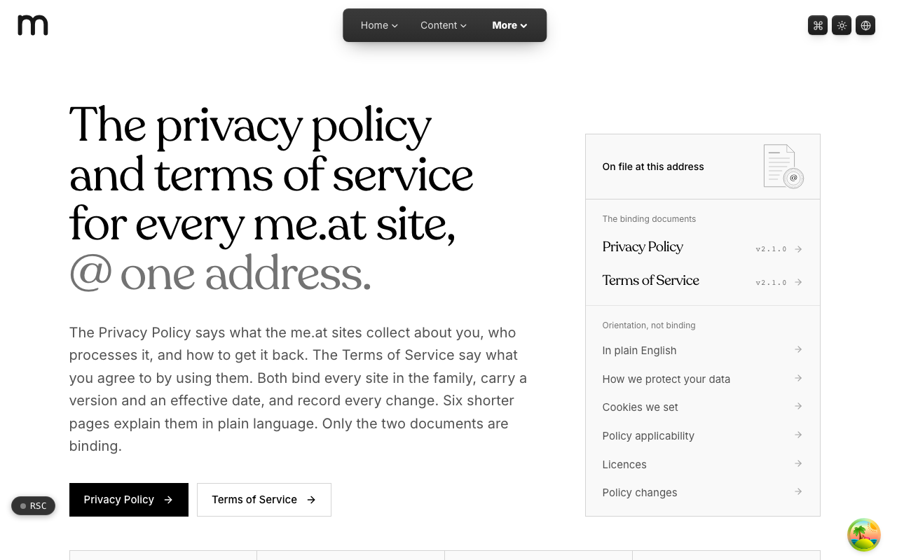
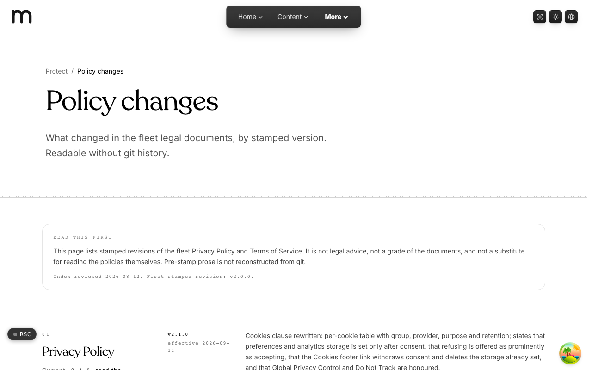
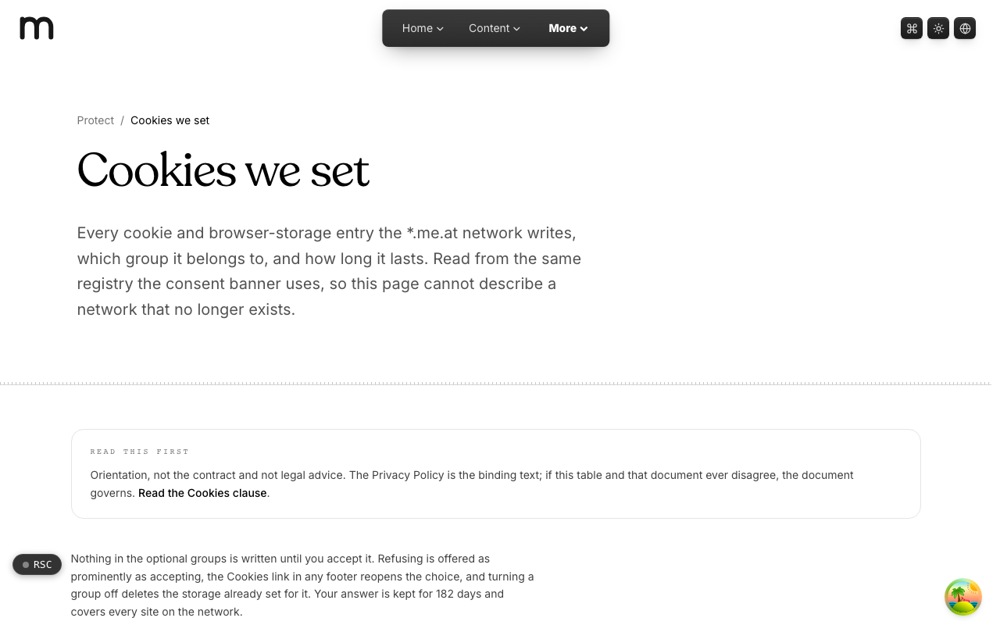
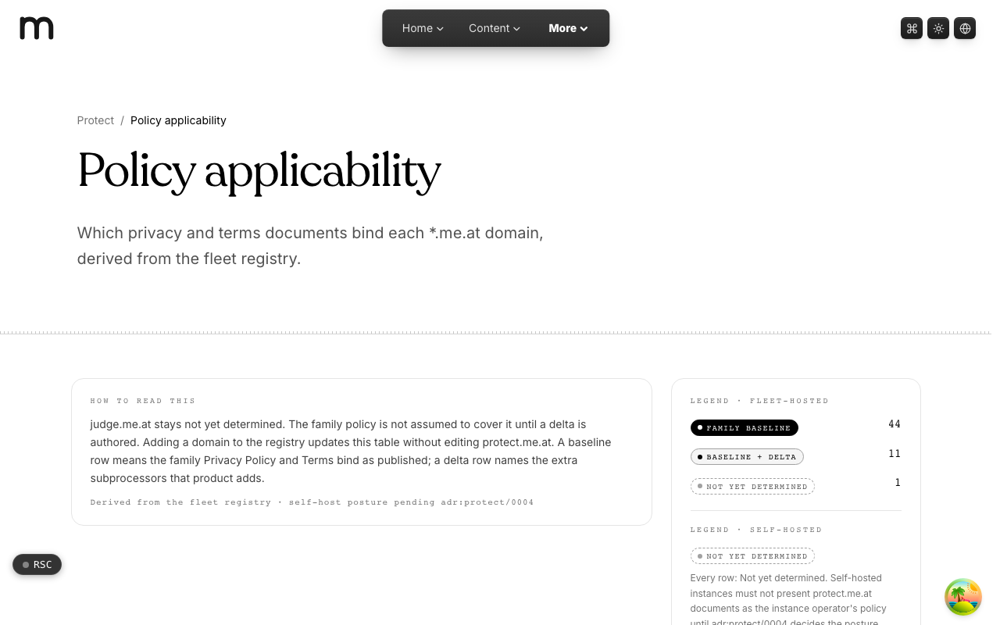
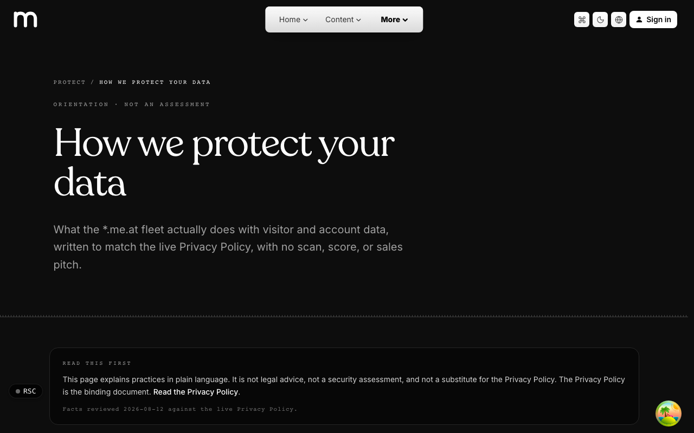

  <picture>
    <source media="(prefers-color-scheme: dark)" srcset=".github/assets/hero-dark.png">
    
  </picture>

# protect.me.at

The privacy policy and terms of service for every me.at site, at one address.

protect.me.at is the legal home of the `*.me.at` family. Every app in the network points its privacy and terms links here, so there is one Privacy Policy and one Terms of Service, each kept as a versioned document with an effective date and a record of every change. Alongside the two binding documents, shorter orientation pages explain them in plain language for anyone who wants the gist before the clauses.

**Live:** [protect.me.at](https://protect.me.at)

## Features

- **Two binding documents**: the Privacy Policy and Terms of Service, each with a live version, effective date and last-updated stamp.
- **Reader layout**: a document masthead, a sticky "On this page" clause rail, numbered clauses and a collapsed plain-English brief.
- **Start from what you need**: the landing page deep-links into the exact clause that answers common questions.
- **Policy changes**: a changelog of stamped revisions, readable without git history.
- **Cookies we set**: every cookie and browser-storage entry the network writes, its group and how long it lasts, read from the same registry the consent banner uses.
- **Policy applicability**: which documents bind each `*.me.at` domain, derived from the fleet registry.
- **Plain-language orientation**: "In plain English", "How we protect your data" and "Licences" pages, clearly marked as non-binding.
- **Eight languages**: the site chrome is translated into English plus seven other locales.

## Screenshots

<table>
  <tr>
    <td width="50%"><picture><source media="(prefers-color-scheme: dark)" srcset=".github/assets/changes-dark.png"></picture> Policy changes: stamped revisions of both documents</td>
    <td width="50%"><picture><source media="(prefers-color-scheme: dark)" srcset=".github/assets/cookies-dark.png"></picture> Cookies we set: every storage entry, its group and lifetime</td>
  </tr>
  <tr>
    <td width="50%"><picture><source media="(prefers-color-scheme: dark)" srcset=".github/assets/applicability-dark.png"></picture> Policy applicability: which documents bind each domain</td>
    <td width="50%"> How we protect your data: practices in plain language</td>
  </tr>
</table>

## Built with

- Next.js 16 (App Router) and React 19
- TypeScript
- Tailwind CSS 4
- MDX documents compiled with Content Collections
- next-intl for localization

## Part of the me.at family

protect.me.at is one of the [`*.me.at`](https://me.at) apps by Trevor McDougald. They share one design system, account, and app shell. Development happens in a private monorepo; this repository is the project's public-facing home.

## License

See [LICENSE](LICENSE).
