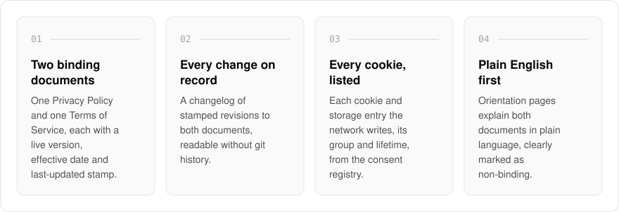
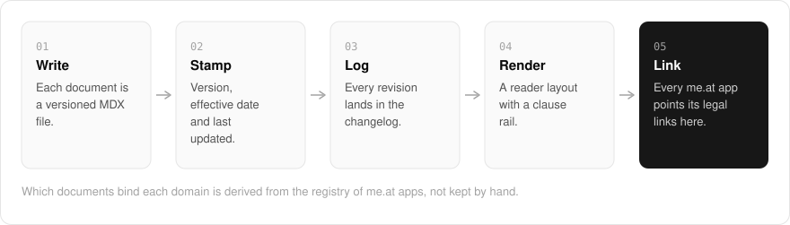

  <picture>
    <source media="(prefers-color-scheme: dark)" srcset=".github/assets/hero-dark.png">
    
  </picture>

<h1 align="center">protect.me.at</h1>

<strong>The privacy policy and terms of service for every me.at site, at one address.</strong>

  
  
  

  <a href="https://protect.me.at">Website</a> ·
  <a href="#features">Features</a> ·
  <a href="#how-it-works">How it works</a> ·
  <a href="#screenshots">Screenshots</a> ·
  <a href="#built-with">Built with</a>

Most privacy policies are a wall of text, and you cannot tell what changed since you last read one. I built protect.me.at as the legal home of my `*.me.at` family: every app in the network points its privacy and terms links here, so there is one Privacy Policy and one Terms of Service, each kept as a versioned document with an effective date and a record of every change. Alongside the two binding documents, shorter orientation pages explain them in plain language for anyone who wants the gist before the clauses.

  <picture>
    <source media="(prefers-color-scheme: dark)" srcset=".github/assets/overview-dark.svg">
    
  </picture>

## Why protect.me.at

| The usual privacy policy | protect.me.at |
| --- | --- |
| One document per site, each drifting on its own | One policy and one set of terms for every me.at site |
| Edited quietly, with only a new date at the top | Stamped revisions in a public changelog |
| "We may use cookies" | Every cookie and storage entry, with its group and lifetime |
| Clauses only | Plain-English pages marked non-binding, and deep links into the clause that answers your question |

## Features

- **Two binding documents**: the Privacy Policy and Terms of Service, each with a live version, effective date and last-updated stamp.
- **Reader layout**: a document masthead, a sticky "On this page" clause rail, numbered clauses and a collapsed plain-English brief.
- **Start from what you need**: the landing page deep-links into the exact clause that answers common questions.
- **Policy changes**: a changelog of stamped revisions, readable without git history.
- **Cookies we set**: every cookie and browser-storage entry the network writes, its group and how long it lasts, read from the same registry the consent banner uses.
- **Policy applicability**: which documents bind each `*.me.at` domain, derived from the fleet registry.
- **Plain-language orientation**: "In plain English", "How we protect your data" and "Licences" pages, clearly marked as non-binding.
- **Eight languages**: the site chrome is translated into English plus seven other locales.

## How it works

  <picture>
    <source media="(prefers-color-scheme: dark)" srcset=".github/assets/flow-dark.svg">
    
  </picture>

Each binding document is an MDX file, stamped with its version, effective date and last-updated date, and every revision is recorded in the public changelog. The site renders both documents in a reader layout with a clause rail and a plain-English brief. Every app in the family links its privacy and terms here, and the applicability page derives which documents bind each domain from the same registry that lists the apps.

## Screenshots

<table>
  <tr>
    <td width="50%"><picture><source media="(prefers-color-scheme: dark)" srcset=".github/assets/privacy-dark.png"></picture> Privacy Policy: the reader layout with its stamps, clause rail and numbered clauses.</td>
    <td width="50%"><picture><source media="(prefers-color-scheme: dark)" srcset=".github/assets/in-plain-english-dark.png"></picture> In plain English: a non-binding summary of both documents.</td>
  </tr>
  <tr>
    <td width="50%"><picture><source media="(prefers-color-scheme: dark)" srcset=".github/assets/changes-dark.png"></picture> Policy changes: stamped revisions of both documents.</td>
    <td width="50%"><picture><source media="(prefers-color-scheme: dark)" srcset=".github/assets/cookies-dark.png"></picture> Cookies we set: every storage entry, its group and lifetime.</td>
  </tr>
  <tr>
    <td width="50%"><picture><source media="(prefers-color-scheme: dark)" srcset=".github/assets/applicability-dark.png"></picture> Policy applicability: which documents bind each domain.</td>
    <td width="50%"><picture><source media="(prefers-color-scheme: dark)" srcset=".github/assets/how-we-protect-dark.png"></picture> How we protect your data: practices in plain language.</td>
  </tr>
</table>

## Built with

  
  
  
  
  
  

- Next.js 16 (App Router) and React 19
- TypeScript
- Tailwind CSS 4
- MDX documents compiled with Content Collections
- next-intl for localization

## Part of the me.at family

protect.me.at is one of my [`*.me.at`](https://me.at) apps. They share one design system, account, and app shell. Development happens in a private monorepo; this repository is the project's public-facing home.

## License

Source-available. See [LICENSE](LICENSE).
